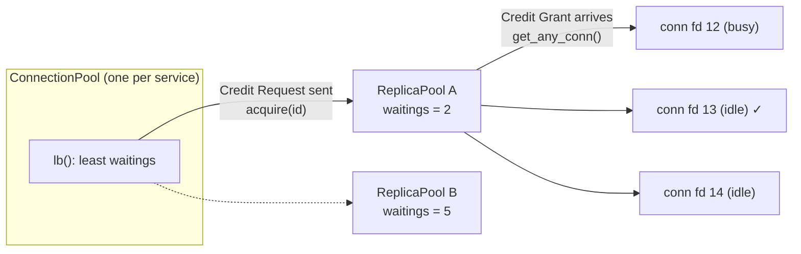
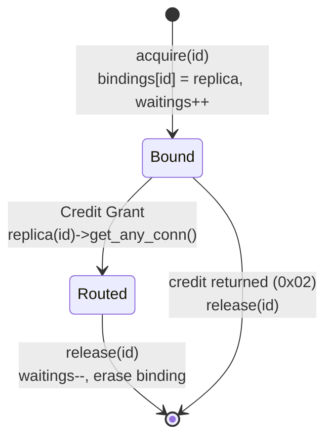
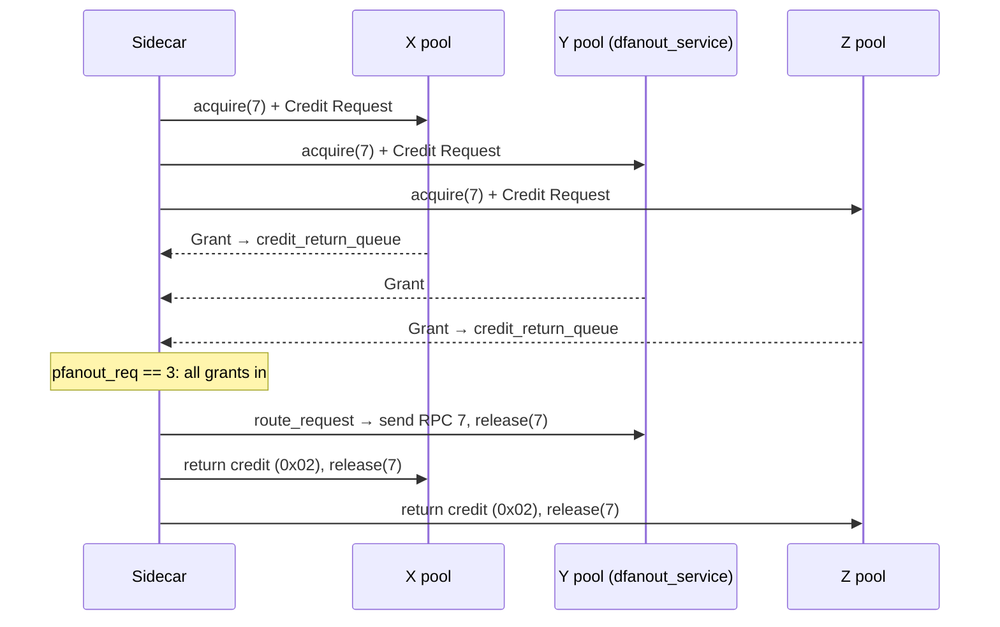
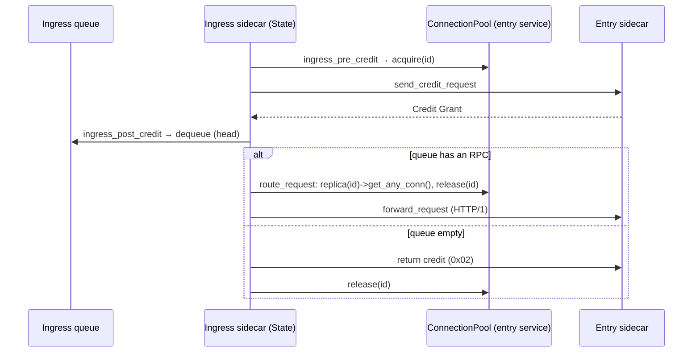

# Load Balancing

## Terminology

- **Ingress:**: Sidecar at the gateway, which used to do overload control.
- **Mesh:**: All other sidecars.
- **Early-binding**: There is a 1:1 mapping between RPC and Credit Request/credit. A credit can only be used for the RPC which issued the corresponding Credit Request.
- **Late-binding**: A credit can be used for any RPC which is pending for credit. The mapping is made after the credit arrives, hence **late**.

## Setup

- Each microservice has multiple replicas.
- There can be multiple connections to a single replica (required for HTTP/1).

## Design

- Two-level selection: To get a connection, we must first **load balance** between replicas (to get a `ReplicaPool`) and then choose a connection available for that replica.
- The load balancing policy is based on least-loaded policy with load being the number of RPCs awaiting for credit.
- Ingress uses late-binding (FCFS deque). Mesh sequential RPCs use late-binding when `mesh_late_binding` is true (default); pfanout/dfanout stay early-binding
- Mesh late-bind queue order is `late_binding_type`: `fcfs` (default, by `req_rcv_time`) or `edf` (by absolute `deadline` header from ingress)
- Ingress issues one Credit Request per request in its queue **concurrently** (`credit_requests_on_fly`) when `ingress_concurrent_credit_requests` is true; default `false`, i.e. one at a time

## Details
### Two-level selection

1. **Replica:** `ConnectionPool::lb()` picks the replica with the minimum waiting count.
2. **Connection (within replica):** `ReplicaPool::get_any_conn()` round-robins over `available()` connections.
   - HTTP/2 (mesh backends): one connection per replica; multiplexed.
   - HTTP/1.1: multiple connections per replica; same idle/available logic as before.

The two levels run at different times. The replica is chosen when the Credit Request leaves; the connection is chosen when the grant comes back.

LB logic lives in the connection pool (when asking for a connection/replica).

### Waiting count tracker

- One `KeyValueMinTracker` (`waitings`) per `ConnectionPool` (i.e. per service), alongside a `bindings` map (`RPCID -> replica_index`). A binding names a replica, never a connection (see [HTTP/1 connections](#http1-connections-ingress--frontend)).
- `increase(replica_index)` on Credit Request send (`acquire`); `decrease(replica_index)` when the credit is resolved (`release`).
- Load counted = outstanding Credit Requests (credits awaited) per replica; used by `lb()` to pick the least-loaded replica.
- All replicas initialized to 0 at startup via `init(index)` in `add_replica`.

### Binding lifecycle

A binding is created per Credit Request and destroyed once its credit is resolved. Everything is keyed by `RPCID`, unique within a pool (dfanout sends one Credit Request per downstream with the same `RPCID`, but into different pools, so keys never collide).

- `acquire(id)` — on Credit Request send: `lb()` picks the replica, store the binding, `increase`.
- `replica(id)` — on routing: return the bound replica, **no mutation**. `route_request` then takes any idle connection to it (`get_any_conn()`).
- `release(id)` — on route success or credit return: `decrease` + erase the binding.

`route_request(type, ds_stream_id, ds_fd, credit_id)` looks up the binding by `credit_id`:

- **Early-binding:** `credit_id == rpc->get_local_id()` — the credit is spent on its own RPC (`PPMQueue::pop(service, id)`; also mesh fan-out).
- **Late-binding:** `credit_id` selects the LB binding; the RPC served is queue head — ingress `dequeue` (FCFS), or mesh sequential `PPMQueue::pop(service)` when `mesh_late_binding` is set (FCFS or EDF per `late_binding_type`).

It does `replica(id)->get_any_conn()` → status check → `release` (EGRESS/committed path only). `get_any_conn` returns only UP connections, so the DOWN/TEARDOWN early-outs no longer fire; a grant with no idle connection to its replica aborts with `NoConnectionException`.

### HTTP/1 connections: Ingress → frontend

The ingress → entry-service hop is the only HTTP/1 hop; mesh hops use one HTTP/2 connection per replica.

- **Pool:** the ingress opens `ingress_pool_connections` (generator `connection_pool_size`, default 200) connections **per entry replica** at startup ([`src/state.cc:98`](../src/state.cc#L98)).
- **One RPC per connection:** a connection turns busy in `HTTP1Connection::submit_request` ([`src/connection.cc:1259`](../src/connection.cc#L1259)) and idle again when the response is read ([`src/connection.cc:1070`](../src/connection.cc#L1070)). `send_sub_request` runs `route_request` and `forward_request` back to back ([`src/state.cc:791-794`](../src/state.cc#L791-L794)), so two grants never pick the same connection.
- **Pick at send:** `acquire` reserves no connection; `route_request` takes any idle one to the granting replica ([`src/state.cc:294`](../src/state.cc#L294)). Connections are held only while an RPC is in flight.
- **Why:** the old design locked one fd per outstanding Credit Request (`binded_fds`). The ingress queue is uncapped in `lb_mode` ([`src/ingress.cc:63`](../src/ingress.cc#L63)), so locked fds grew with queue depth until `acquire` aborted with `No conn available to acquire` (35 ingress logs, EDF units, alibaba-lb 1,200–1,600 RPS and fanin-lb-scale 1,800 RPS). Raising the pool to 600 only delayed it.
- **Sizing:** connections needed per replica ≈ its credit limit, not the queue depth; leave headroom, since the limit moves at runtime and a new grant can arrive before the previous response is read. An undersized pool aborts at grant time with `No connection available for routing request`.

### Tie-breaking

When multiple replicas have the same waiting count, one is chosen **uniformly at random** among those ties (`KeyValueMinTracker::get_min`).

### dfanout

- **All downstreams:** `get_pool(ds_service).acquire(id)` → a binding in each downstream's own pool + a Credit Request sent to it.
- **Primary (`dfanout_service`):** the credit is spent — `route_request` (`replica`+`release`) forwards the sub-request.
- **Others:** credit returned via `0x02`; the binding is released during the credit-return flush (`get_pool(*ret->ret_service).release(ret->ret_id)`), after all credits have arrived.

Example: RPC 7 targets service Y, and the mapping lists downstreams X, Y and Z. The sidecar sets `dfanout_service = Y` when it sends the Credit Requests (`protocol_client`), waits for all three grants, spends Y's, and returns the others.

### Assumptions

- `State` is thread-local; the event loop processes one RPC step at a time per thread.
- Mesh path has no request drops (drops are ingress-only).
- Ingress may have multiple outstanding Credit Requests (`credit_requests_on_fly`); each has its own binding keyed by `RPCID`.

### Performance

- `KeyValueMinTracker` does O(log R) per update and O(t) min lookup over the tie group (t ≤ R, R typically small).
- `bindings` is O(1) per `acquire`/`replica`/`release`. No heap allocations on the LB hot path.
- Mesh `PPMQueue` (`FlexiblePriorityQueue`) is O(log n) push/pop.

## Call path

**Ingress:** `ingress_pre_credit` → `ConnectionPool::acquire(id)` (bind + waiting++) → `send_credit_request` → *(Credit Grant)* → `ingress_post_credit` → `Ingress::dequeue` (head) → `send_sub_request(head, credit_id)` → `route_request` (`replica`→`get_any_conn`→`release`) → `forward_request`. Empty queue → return credit (`0x02`) + `release(credit_id)`.

**Mesh:** `protocol_client(false)` → `register_id_map` → `acquire(id)` per downstream → `send_credit_request` → `PPMQueue::push` (priority = deadline or `req_rcv_time`) → *(Credit Grant)* → `protocol_client(true)` → `fanout_req_management` (sequential: `pop(service)` if `mesh_late_binding`, else `pop(service, credit_id)`; fan-out: pop by `credit_id`) → `get_egress_rpc` → `send_sub_request` → `route_request` (`replica`→`get_any_conn`→`release`); returned credits `release`d on flush.

## Key code

`ConnectionPool::acquire` / `replica` / `release` / `lb`, `ReplicaPool::get_any_conn`, `KeyValueMinTracker`, `FlexiblePriorityQueue`, `PPMQueue::push` / `pop`.

Mesh: `State::protocol_client`, `State::fanout_req_management`, `State::send_sub_request`, `State::route_request`.

Ingress: `State::ingress_pre_credit`, `State::ingress_post_credit`, `State::send_sub_request`, `State::route_request`.
